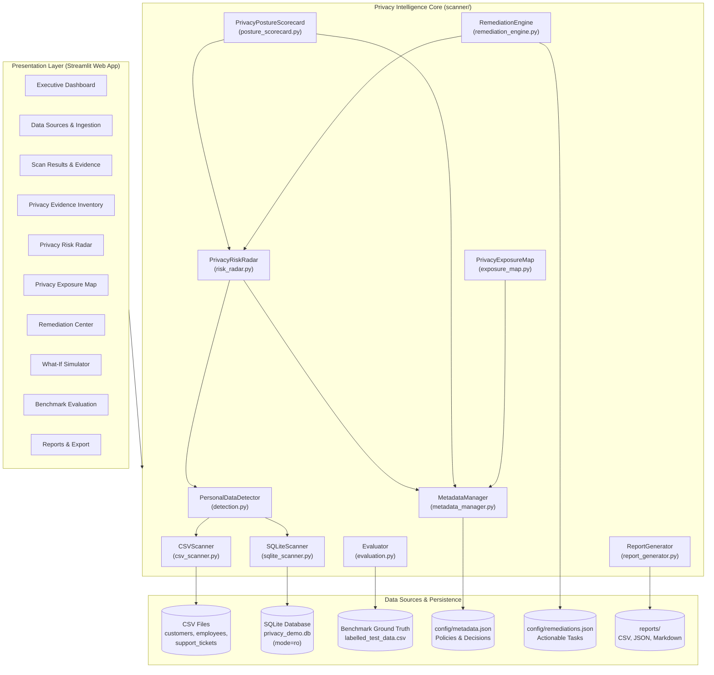
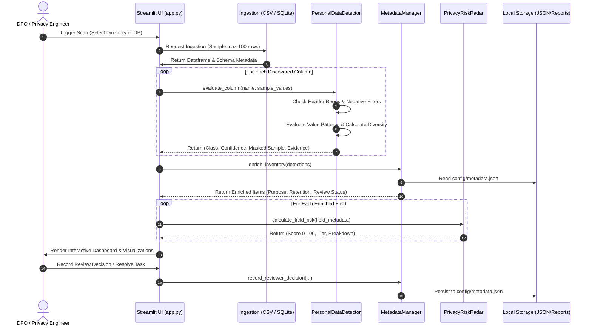
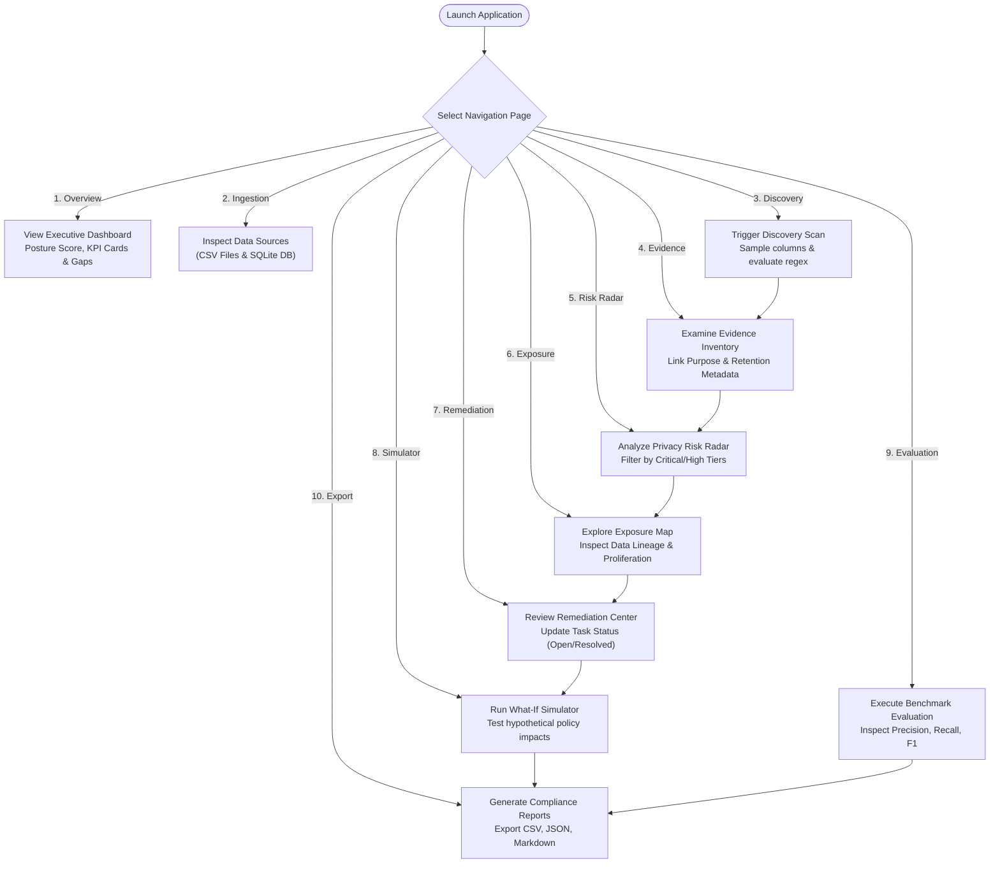
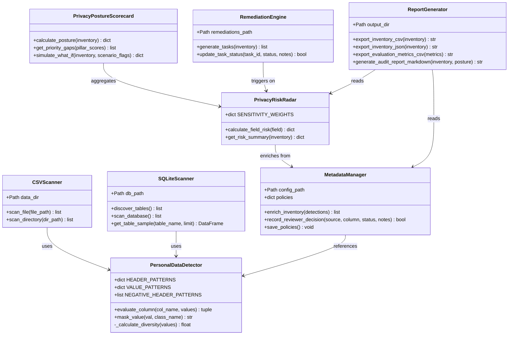

# 03. System Architecture and Design
**Project:** PS-019 Privacy Intelligence Engine  
**Team ID:** Team A3-PS019-TC316  
**Implementation:** Modular Python Architecture with Streamlit UI & SQLite Ingestion  

---

## 1. High-Level Architecture Overview

The **Privacy Intelligence Engine** employs a decoupled, multi-tier architecture designed around four primary layers:
1. **Presentation & Interaction Layer:** Streamlit-based web dashboard (`app.py`) providing modern light SaaS visual aesthetics, reactive controls, interactive Plotly visualizations, and tabular audit logs.
2. **Intelligence & Analysis Layer:** Domain modules covering heuristic detection, explainable risk scoring, data lineage mapping, automated remediation synthesis, and governance posture evaluation.
3. **Data Ingestion & Discovery Layer:** Safe, bounded-sampling connectors for Delimited CSV text files and relational SQLite databases.
4. **Persistence & Evidence Store Layer:** Local JSON governance configuration (`config/metadata.json`, `config/remediations.json`) and audit output files (`reports/`).

---

## 2. Component Responsibilities & Module Catalog

### 2.1 Application Entry Point (`app.py` & `src/app.py`)
- Coordinates Streamlit page state, routing between 10 navigation views.
- Handles reactive widget triggers (buttons, dropdowns, radio toggles).
- Applies modern light SaaS styling via injected custom CSS.
- Encapsulates error handling for file uploads and database browsing.

### 2.2 Personal Data Detector (`scanner/detection.py`)
- Implements `PersonalDataDetector`.
- Houses compiled regular expression patterns for 5 personal data classes:
  - `NAME`, `EMAIL`, `PHONE_NUMBER`, `ADDRESS`, `GOVERNMENT_ID`.
- Executes header keyword matching and negative-header exclusion filters.
- Computes heuristic confidence scores based on header (+0.4), value match ratio (+0.5), and value diversity (+0.1).
- Provides data masking routines for UI presentation and export sanitization.

### 2.3 Data Ingestion Connectors (`scanner/csv_scanner.py` & `scanner/sqlite_scanner.py`)
- **`CSVScanner`:**
  - Safely loads CSV files with delimiter sniffing (comma, semicolon, tab).
  - Implements bounded row sampling (first 100 non-null values per column) to prevent high memory usage.
  - Recovers gracefully from UTF-8 decode errors via fallback to ISO-8859-1.
- **`SQLiteScanner`:**
  - Connects to SQLite databases using read-only URI connection strings (`file:...mode=ro`).
  - Enumerates all tables via `sqlite_master` catalog queries.
  - Introspects column definitions with `PRAGMA table_info`.
  - Samples up to 100 rows per table with `LIMIT 100`.

### 2.4 Metadata & Evidence Manager (`scanner/metadata_manager.py`)
- Implements `MetadataManager`.
- Interfaces with `config/metadata.json` for organizational data policies.
- Enriches scanner candidate fields with declared business purposes and retention periods.
- Records and persists DPO human verification decisions (`Pending Review`, `Confirmed PII`, `False Positive`, `Excluded`).

### 2.5 Explainable Privacy Risk Radar (`scanner/risk_radar.py`)
- Implements `PrivacyRiskRadar`.
- Calculates an explainable 0–100 risk score for each detected personal data column.
- Factors: Data sensitivity (35 pts), detection confidence (15 pts), missing purpose (20 pts), retention overages (15 pts), review status (15 pts), cross-source proliferation (15 pts).
- Assigns priority tiers (`Critical`, `High`, `Medium`, `Low`) and generates human-readable factor contribution breakdowns.

### 2.6 Privacy Exposure Lineage Map (`scanner/exposure_map.py`)
- Implements `PrivacyExposureMap`.
- Generates 4-tier Sankey data flow models: `Source → Class → Purpose → Governance Status`.
- Detects cross-source proliferation where identical personal data classes reside across multiple physical databases.
- Highlights unapproved or orphan data flows in visual alert colors.

### 2.7 Intelligent Remediation Engine (`scanner/remediation_engine.py`)
- Implements `RemediationEngine`.
- Generates structured, prioritized remediation tickets for compliance deficits.
- Manages ticket lifecycles (`Open`, `In Progress`, `Resolved`) with persistent JSON storage in `config/remediations.json`.
- Strictly maintains read-only boundaries: never modifies underlying data assets.

### 2.8 Posture Scorecard & What-If Simulator (`scanner/posture_scorecard.py`)
- Implements `PrivacyPostureScorecard`.
- Synthesizes institutional compliance into a composite 0–100 index across 5 pillars:
  - Human Review Coverage (25%), Purpose Approval (25%), Retention Schedule (20%), High-Risk Resolution (20%), Evidence Logging (10%).
- Provides in-memory What-If scenario projections without altering persistent governance state.

### 2.9 Empirical Evaluator (`scanner/evaluation.py`)
- Implements `Evaluator`.
- Ingests ground-truth labeled benchmark data (`data/labelled_test_data.csv`).
- Calculates standardized performance metrics via `scikit-learn`: Macro Precision, Recall, F1-score, per-class breakdown, and confusion matrices.
- Renders confusion matrix visualization heatmaps using Matplotlib/Seaborn.

### 2.10 Compliance Report Generator (`scanner/report_generator.py`)
- Implements `ReportGenerator`.
- Generates audit deliverables in `reports/`:
  - `privacy_evidence_inventory.csv`: Tabular inventory with masked samples and risk ratings.
  - `privacy_evidence_inventory.json`: Full nested schema with lineage and remediation metadata.
  - `evaluation_benchmark.csv`: Metric table for precision/recall validation.
  - `privacy_audit_report.md`: Formal Markdown compliance document for regulatory filing.

---

## 3. Data Processing Pipeline (Mermaid)

---

## 4. User Workflow Diagram (Mermaid)

---

## 5. Component Interaction & Class Diagram (Mermaid)

---

## 6. State Management and Persistence

The application maintains state across three distinct mechanisms:
1. **Streamlit Session State (`st.session_state`):**
   - Active scan results (`scanned_inventory`).
   - Current navigation page and demo mode steps.
   - Dynamic simulation slider parameters.
2. **Local Governance Metadata (`config/metadata.json`):**
   - Stores declared purposes for specific column paths (`customers.csv::email_address`).
   - Stores official retention limits (e.g., 180 days, 365 days).
   - Stores human review verification audit stamps and reviewer notes.
3. **Remediation Task Store (`config/remediations.json`):**
   - Stores generated compliance tickets.
   - Tracks resolution lifecycle states (`Open`, `In Progress`, `Resolved`) and timestamps.

---

## 7. Error Handling & Fault Isolation Flow

- **Corrupted / Empty Files:** `CSVScanner` validates row counts; files with zero non-null values return empty detection sets without unhandled exceptions.
- **Encoding Anomalies:** When standard UTF-8 parsing fails, the reader automatically falls back to ISO-8859-1 (Latin-1), preventing ingestion crashes.
- **Database Locks / Concurrency:** SQLite connections are strictly opened with `uri=True` and `mode=ro`. No exclusive write locks are requested, guaranteeing zero risk of corruption to target databases.
- **Missing Configuration Files:** If `config/metadata.json` or `config/remediations.json` is missing or unparseable, default fallback policies are automatically populated in memory.
